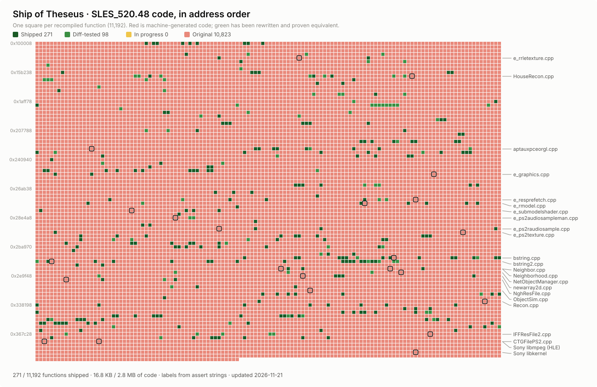

# The Sims Bustin' Out — PS2 Static Recompilation


A static recompilation of the PlayStation 2 game **The Sims Bustin' Out** (PAL, `SLES-52048`) to native
x86-64 Linux, built on [PS2Recomp](https://github.com/ran-j/PS2Recomp). The game's MIPS R5900 machine code is
translated function by function into C++ and compiled into a native executable. PS2 hardware and the
operating-system services the game uses (threads, semaphores, IOP modules, memory cards, pad, movies) are
provided by PS2Recomp's runtime, extended with the fixes this game needed.

The long-term plan is a **Ship of Theseus**: replace the machine-generated functions one at a time with
readable, hand-written code that is proven to behave identically, until none of the original remains.
This repo is also a reference for a future Rust rewrite.

## Important note

**This project does not condone piracy.** No game files are included. You need your own copy of the game.
The recompilation was made from:

| File | SHA-256 |
|---|---|
| `SLES_520.48` (the game's main executable, from *Sims, The - Bustin' Out (Europe) (En,Sv,No,Da,Fi)*) | `ca01f80b4dd960990329a30a588ef53e7a67ea111eaccff58dcdad81549f656a` |

**AI assistance is used in this repo. The later rust rewrite will not.**

## Current status

The game boots and is playable as far as Create-A-Sim and loading into a house, but it is not yet
playable in a meaningful way.

- [x] Boots: EA and Maxis logos, intro movie (MPEG movies decoded through an FFmpeg-backed `sceMpeg` HLE)
- [x] Front end: language menu, autosave notice, memory-card check, main menu
- [x] Create-A-Sim reached; loads into a house
- [x] Memory-card saves (stored in `runtime-data/`)
- [x] Keyboard and gamepad input (SDL2 GameController, e.g. a Steam Controller)
- [ ] 3D rendering is wrong (flat sky, untextured geometry, wrong camera)
- [ ] Some front-end UI is misaligned
- [ ] Performance: about 1–3 fps, roughly 5% of real-time speed (profiling is next)
- [ ] Audio, networking: not looked at yet

## Ship of Theseus



Each square is one recompiled function of `SLES_520.48`, in address order. **Red** squares are still
machine-generated code. As functions are rewritten by hand they go **amber** (in progress), **light green**
(diff-tested: the rewrite matched the original on 200,000 random CPU states) and **dark green** (shipped in
the game build). The linker keeps each source file's functions together, so whole files and subsystems
fill in as blocks. The game has no symbols, so the labels come from assert messages left in the release
build (`bstring.cpp`, `NghResFile.cpp`, …).

The image is generated by `python3 tools/theseus/progress.py` from the rewrite ledger
`tools/theseus/batch/ledger.tsv` (a git pre-commit hook regenerates it when the ledger changes).

**Pilot (November 2026):** 10 functions of the game's reference-counted string class (`bstring.cpp`,
`bstring2.cpp`) rewritten as readable C++ in `tools/theseus/rewrites/`, e.g. `bstring_AddRef`,
`bstring_InitEmpty`, three conversions between 8-, 16- and 32-bit strings, and a constructor that
registers objects in a global list. All 10 pass the gate (110/110 mutants caught) and run in the game.

How a function gets replaced (all from the repo root, design ported from the Fable II recompilation):

| Step | Command | What it does |
|---|---|---|
| Inventory | `python3 tools/theseus/inventory.py --pilot` | Every recompiled function: size, calls, loops, FPU/MMI use, source-file evidence |
| Diff test | `python3 tools/theseus/difftest.py <rewrite>` | Original and rewrite on 200,000 random CPU states and memory; return value, saved registers, memory and hardware traffic must match |
| Caller check | `python3 tools/theseus/caller_usage.py <rewrite>` | Follows every caller after the call: no one may read a scratch register the rewrite leaves different |
| Gate | `python3 tools/theseus/gate.py <rewrite>...` | Both of the above, plus mutants of the rewrite that must all be caught; writes the ledger |
| Ship | `python3 tools/theseus/ship.py`, rebuild | The game registers each gated rewrite at its function's address (`SIMS_THESEUS=0` runs the originals) |

## Building

Linux only for now. You need CMake 3.21+, a C++20 compiler (GCC or Clang), a CPU with AVX2, pkg-config and the
FFmpeg development libraries (`libavcodec`, `libavformat`, `libavutil`, `libswresample`, `libswscale`; used for
the game's movies). SDL2 is optional (gamepad support). raylib is fetched by CMake.

**PS2Recomp:** the build expects PS2Recomp at `references/PS2Recomp` (git-ignored), on a local branch
(`sims-bustin-out-fixes`) with runtime fixes that are not published yet. Until they are, the build cannot be
reproduced from this repo alone.

**Game files:** extract the disc into `work/sims-bustin-out/disc-files/`, then recompile with PS2Recomp's
`ps2_recomp` into `work/sims-bustin-out/functions-only-output` and `supplemental-output`.
[`HANDOFF.md`](HANDOFF.md) has the exact regeneration commands for the supplemental functions and native
bindings (both driven by files in `config/`).

Then, from the repo root:

```sh
cmake -S config/probe -B build/probe -DCMAKE_BUILD_TYPE=Release   # configure once
cmake --build build/probe --target sims_boot_probe -j 12           # ~20 min the first time
build/probe/sims_boot_probe work/sims-bustin-out/disc-files/SLES_520.48 600 --visible
```

The second argument is how many seconds to run. Without `--visible` it runs headless (used for tests and
traces).

### Gamepad mapping

| Controller | PS2 |
|---|---|
| A / B / X / Y | ✕ / ◯ / □ / △ |
| LB / RB | L1 / R1 |
| LT / RT | L2 / R2 |
| Start / Back | START / SELECT |

## Repository layout

| Path | What it holds |
|---|---|
| `config/` | Tracked inputs: the native build (`probe/CMakeLists.txt`), supplemental function map, native bindings |
| `tools/` | Analysis and generation scripts (function recovery, xrefs, VU disassembler, boot probe, Theseus) |
| `docs/` | Devlog and generated progress images |
| `HANDOFF.md` | Detailed working notes: current state, investigation history, debug switches |
| `references/`, `work/`, `build/`, `runtime-data/` | Git-ignored: PS2Recomp checkout, game files and generated code, build tree, saves |

## Credits

- [PS2Recomp](https://github.com/ran-j/PS2Recomp) — the recompiler and runtime this project is built on
- [PCSX2](https://github.com/PCSX2/pcsx2) — used as the reference for hardware behaviour and to compare memory state
- [Ghidra](https://github.com/NationalSecurityAgency/ghidra) — disassembly and decompilation
