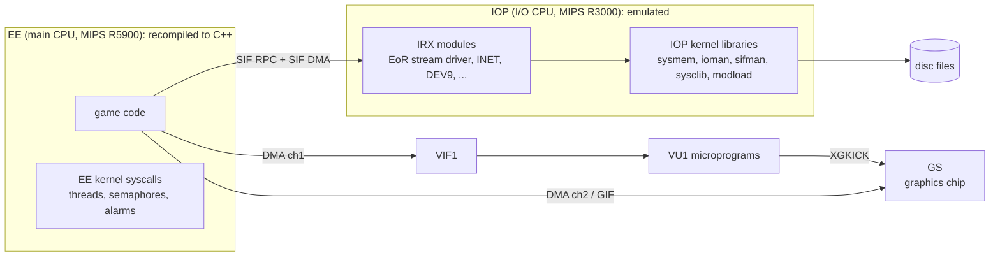

# Devlog 2026-11-12: from a stuck boot to the first GS output

This is a write-up of one long session on the Sims Bustin' Out (PAL, `SLES_520.48`)
static recompilation. It covers what broke, how each problem was narrowed down,
the dead ends, and the PS2 concepts behind each fix. It's written as learning
material, especially for a later rewrite of the runtime in Rust.

**Where we started:** the native build loaded 8 IOP modules, then stalled. The
main thread waited forever on semaphore 18, and nothing was ever drawn.

**Where we ended:** startup completes, the game loads its data archives, runs its
frame loop and sends about 2,200 DMA transfers and 750 GIF packets in 40 seconds.
The screen is still black, and that has been traced to the VU1 path (see the end).

---

## 0. A map of the machine

Almost every bug in this session sat on a boundary between processors, so it
helps to have the picture first:



- **SIF** is the bridge between EE and IOP. The EE calls IOP "servers" by RPC,
  and the IOP pushes data back to EE memory with SIF DMA.
- **IRX** files are IOP modules (relocatable ELFs). Each one *imports* functions
  from IOP kernel libraries by `library:ordinal`, e.g. `sifman:32`. In PS2Recomp
  those libraries are implemented in C++ (`ps2xIOP/src/emulator/imports/`). **An
  ordinal the emulator doesn't implement quietly returns 0**, and that one fact
  caused several of today's bugs.

---

## 1. The stream that always said "try again" (`-3`)

### Symptom
A worker thread repeatedly called IOP RPC server `0x12345`, function 5. Every
reply was `0xFFFFFFFD` (`-3`), and the EE retried forever. Earlier sessions had
traced the IOP side to the branch that sets `-3`, but not *why*.

### How it was narrowed down
1. **Which module owns the server?** The server's callback was at IOP address
   `0x23468`. The module load log showed module 5 at base `0x21f00`, but that
   module was loaded from a memory buffer, not from a named file.
2. **Find the module's bytes.** `grep` for its banner string
   (`EoR I/O driver`) found it inside `MODULEU.DAT`. A 20-line Python script
   split that file at every `\x7fELF` header and extracted 20 IRX modules.
3. **Confirm the load address.** The extracted ELF's entry point `0x1780` plus base
   `0x21f00` gives `0x23680`, matching the runtime log exactly. Always verify
   this before trusting any address arithmetic.
4. **Disassemble it.** IRX files use a custom ELF type (`0xFF80`), so I patched
   it to `ET_REL` (1) and used
   `llvm-objdump -d -r --triple=mipsel --adjust-vma=0x21f00`. `--adjust-vma`
   makes the listing show the same addresses as the runtime logs.
5. **List its imports.** Scanning `.text` for the import-table magic
   `0x41E00000` lists every `library:ordinal` the module uses. Notably it had
   `ioman` (file I/O) and `libsd` (sound) but **no `cdvdman`**, so it's an
   audio/data **streaming driver** that reads files through `ioman`.
6. **Read the logic backwards from `-3`.**
   - `-3` means "not at end-of-file, but no data available yet; come back later".
   - The producer thread had *already* buffered all 5,992 bytes of `INDEX.IND`.
     (The repeated "read 1,896 bytes at EOF → 0" calls that earlier sessions
     suspected were just normal polling.)
   - So the **consumer** was failing to hand the data to the EE. Its copy
     routine called `sifman` import **#32**, `sceSifSetDmaIntr`. If that returns
     0 the routine copies nothing.
7. **Check the emulator.** `IopRpcBridge::dispatchSifManImport` handled
   ordinals 4, 5, 7, 8 and 29. **Everything else fell to `default: return 0`.**

### The concept
`sceSifSetDmaIntr(transfers, count, handler, arg)` is `sceSifSetDma` plus a
**completion callback**. The driver's handler calls `iSignalSema`, and right
after starting the DMA the driver waits on that semaphore. So a correct fix
has two halves:
1. do the transfer, and
2. **run the guest's handler later**, the way an interrupt would.

If you only do half 1, the driver moves from "returns -3 forever" to
"blocks forever on the semaphore".

### The fix
- Moved the existing `sceSifSetDma` copy into a shared helper.
- Ordinal 32 does the same copy, then records `{handler, caller's $gp, arg}`.
- The emulator queues that record as a deferred guest callback, using the same
  mechanism `cdvdman` uses for "read finished" callbacks.

**Result:** 8 → 14 IOP modules, and the USB keyboard server registered for the first time.

> **Rust note:** "unknown ordinal returns 0" is how silent failures like this
> happen. In a Rust port, make import dispatch return something like
> `Result<u32, UnhandledImport>` and log or count every miss. A `match` on
> `(library, ordinal)` with an explicit `_ => Err(...)` arm makes the gap visible.

---

## 2. The modules that printed `Usage:` and quit

### Symptom
After fix 1, three new kinds of warning appeared: `modload:16`, `netdev:6/14`, and an
unimplemented EE syscall. NETCNF and INETCTL printed their usage text, and INET
returned `1` from its start function.

### How it was narrowed down
- `Usage:` means a program didn't like its arguments. Those arguments come
  from the game through `ExecModuleBuffer`, so I followed them:
  1. The EE-side bridge read them correctly.
  2. The IOP loader then called the module entry as
     `entry(argumentByteCount, pointerToRawBytes)`.
- An IRX entry point is **`int _start(int argc, char *argv[])`**, the same as C
  `main`. The module was treating characters as pointers.

### The fix
Build a real `argv` block in IOP RAM:
- `argv[0]` = module name;
- then the caller's NUL-separated strings;
- then `NULL`.

Even with no arguments, `argc` is 1. A tiny synthetic IRX is the regression
test: its `_start` returns `argc<<16 | argv[2][0]<<8 | argv[1][0]`, and given
`"ab\0cd\0"` it must return `0x36361`.

**Result:** NETCNF and INETCTL started correctly.

---

## 3. INET still failed: `isdigit` was always false

### How it was narrowed down
INET's error messages go to its own internal log buffer, not to `stdio`, so
the runtime never printed them. Instead of reading every failure branch, I
added a **temporary, environment-gated import trace** that logs every import INET
calls with its arguments and return value, ran it once, and removed it afterwards.

The trace answered it in one line:
```
sysclib:29 (strncmp "mem=" ...) -> 0      matched the option prefix
sysclib:8  ('9')                -> 0      "is '9' a digit?" ... no?!
```
`sysclib:8` is `look_ctype_table(c)`, the table behind `isdigit`, `isalpha` and
so on. The emulator returned 0 for every character, so INET decided `mem=96K` was
malformed and unloaded itself. Because INET also *exports* the `inet` and `netdev`
libraries, every later module that imported them failed as well. One root cause
produced a dozen warnings.

### The fix
Implement the newlib flag bits that IOP modules test directly:
`U=01 L=02 N=04 S=08 P=10 C=20 X=40 B=80`.

> **Lesson:** when many warnings appear together, look for the one module
> they all depend on. `netdev:6` wasn't missing; its *exporter* was dead.

---

## 4. Smaller fixes along the way

| Problem | Concept | Fix |
|---|---|---|
| A periodic timer fired once, then never again | Negative EE syscall numbers are the interrupt-safe "i" variants. This game uses `0xFC SetAlarm, 0xFD ReleaseAlarm, -0xFE iSetAlarm, -0xFF iReleaseAlarm`. The handler re-arms itself with `iSetAlarm`. | Added `0xFD` and `-0xFE` to the dispatcher |
| `ExecModuleBuffer iop=0x0`, then the loader ran garbage | The IOP heap started every search at its high-water mark, so `free` never made space reusable. Once INET stayed loaded, memory ran out. | First-fit from the heap base; reject address 0 |
| Thread 2 stuck in a loop at `0x39b9e0` | That's the loadfile RPC bind loop (SID `0x80000006`), which runs when the game loads `cdrom0:\DEV9.IRX` *by path*. No BIOS loadfile server exists here. | Native binding for `sceSifLoadStartModule` that calls the IOP emulator's path loader |

---

## 5. Functions hidden inside other functions

### Symptom
`guest-branch:missing-target ... target=0x2952d0`, then the game thread exited.

### Why it happens
The function map came from the Ghidra MCP, which reported function *starts*
only, so every end was approximated as "the next start". Small functions that
Ghidra never recognised, such as vtable methods, got swallowed into the
previous entry. Disassembling `0x2952c8–0x295368` showed **three** functions
in one map entry.

### Instead of fixing them one crash at a time
I dumped the vtable the crash came from and checked every slot against the
known function starts. **Three** were missing. So I wrote a general tool,
`tools/recover_data_referenced_functions.py`:
1. Find **candidate addresses** in two places:
   - words in data sections that point into code (vtables, callback tables);
   - `lui` + `addiu`/`ori` pairs in code (function pointers built at runtime).
2. **Filter out lookalikes.** A candidate must either:
   - sit right after another function's `jr $ra` + delay slot (optionally + a nop pad), or
   - be in a table whose neighbouring slots are known functions.

   (This correctly rejected one address that followed a `jr $4` jump-table
   dispatch: that's a `switch` case, not a function.)
3. **Find each function's end** with a linear sweep. Track the furthest forward
   branch target, and stop at the first `jr $ra` (or tail-call `j`) whose delay
   slot lies past every target seen so far.

It recovered 618 functions, and the recompile had 0 errors. The game then ran
the full 40 seconds, and the GIF counter started climbing for the first time.

> **Rust note:** this recovery pass is a nice self-contained first Rust project:
> parse the ELF, decode MIPS words, build sets, write CSV. Crates like `goblin` (ELF)
> and `csv` cover the I/O, and the sweep logic is a good exercise in iterators
> and `HashSet`.

---

## 6. The big misread: semaphore 18

For several sessions "main thread blocked on sema 18" was treated as *the*
bug. This session disassembled what the waiter does **after** the wait:

```
WaitSema(this->sema)        // sema 18
shut down sound / IOP ...   // teardown calls
busy-wait ~100 timer ticks
DeleteSema(this->sema)
```

And the "signal" method is just `SignalSema(this->sema)`. **Semaphore 18 is the
"quit the game" signal.** `main()` starts the worker threads and sleeps until
shutdown, as many PS2 games do. The real game runs on the other threads.

> **Lesson:** before treating a wait as the bug, read what happens after the
> wait returns, and look at what the *other* threads are doing.

---

## 7. Black screen: following the pixels

The user ran the probe with `--visible` and saw black. The investigation went
roughly like a bisection, each step adding a small **opt-in** diagnostic (an
environment variable, off by default) instead of permanent logging:

| Question | Tool added | Answer |
|---|---|---|
| Is it really black, or a presentation bug? | `SIMS_FRAME_DUMP_DIR` saves frames as PPM files, sampling every 61st frame (odd, so both double-buffer pages are covered) | Both pages black, apart from ~30 stray pixels |
| Is the game still loading? | `SIMS_IOP_FILE_TRACE` logs IOP opens and reads | All archive I/O finishes within ~2 s; then it's idle |
| What is the GS asked to draw? | `SIMS_GS_STATS` primitive histogram | Black full-screen clears, plus ~137/s **points at GS (0,0)** with random colours |
| What do those packets contain? | `SIMS_GIF_DUMP` raw bytes | **IEEE floats** (`0x3f800000` = 1.0 …), not GIF tags |
| Which path delivers them? | `[dma:gif-tag]` under `SIMS_DMA_TRACE` | The GIF DMA chains are valid texture uploads; the floats come from **VU1 `XGKICK`** |
| What is VU1 doing? | `SIMS_VIF1_TRACE` VIF codes + kick addresses | Kick addresses beyond VU memory (`0x5ee`, `0x78c` …) and ~3,900 "XGKICK overflow" reports in 12 s |

**Current understanding:** the game uploads VU1 microprograms (`MPG`) and
vertex data (`UNPACK`, with `BASE`/`OFFSET` double buffering). VU1 is meant to
turn those floats into GS packets and `XGKICK` them. Somewhere in that
microprogram emulation the addresses or data go wrong, so VU1 kicks its *input*
buffer instead of its *output*. That's the next thing to debug.

### 7b. Catching the failing VU1 run red-handed

Reading a 1,700-line VU interpreter wasn't going to find this. A recorder was
more useful: log every instruction of each microprogram run into a buffer,
throw the buffer away when the run is fine, and **save it only for the first
run that fails**, together with raw dumps of VU1 code and data memory
(`SIMS_VU1_TRACE_DIR`).

The failing run's last few instructions, decoded by hand:

```
0b80  ILW.w  vi3, 0x30(vi0)   ; load "where my packet is" from VU memory
0b90  XGKICK vi3              ; send it to the GS
...   (subroutine) ISW.w vi12, 0x30(vi0)   ; remember where the NEXT packet goes
```

The program is **pipelined across calls**: each call kicks the packet the
*previous* call built. On the very first call nothing has been stored yet, so it
kicks from address 0. That's harmless on a real PS2. **PCSX2's source**
(`Gif_Unit::GetGSPacketSize`) shows that an XGKICK packet larger than VU memory
is simply dropped while VU1 keeps running. PS2Recomp instead *aborted the whole
microprogram*, killing the run that would have built the next good packet. That
mismatch is now fixed and has a test.

The screen is still black, though: every later kick also finds garbage, so the
program's output buffer never receives a valid GIF packet. That's the open
problem for the next session.

> **Lesson:** when an emulator and real hardware disagree about an edge case,
> a mature reference emulator's source (PCSX2 here) is often the quickest
> authority. Its comments even say "Bios does this".

> **Lesson:** a black screen tells you almost nothing on its own. Each layer
> (presentation → GS draws → GIF packets → DMA path → VU1) has a cheap question
> that rules half the system in or out.

---

## 8. The breakthrough: ground truth from a PCSX2 save state

Disassembling microprogram `0x910` (with the new `tools/vu_disasm.py`) showed
that it copies a **GIF tag template from VU1 qword 3** and keeps a **buffer
pointer in qword `0x30`**. In our run both were zero, and nothing in the VIF
stream, the VU code or (apparently) the EE ever wrote them. Reasoning had hit
its limit, so we went to a working PS2:

1. **PINE first.** Reads of VU memory came back as zeros. PCSX2's source showed
   why: PINE uses `vtlb_ramRead`, which returns 0 for hardware-handler pages. A
   good lesson in checking a tool's blind spots before trusting "0".
2. **Save state instead.** A `.p2s` file is just a zip, and `vu1Memory.bin`
   inside it showed exactly the expected template and pointer.
3. **Find the writer.** Searching the game's EE code for the template's unusual
   constant (`0x801e` = 30 loops + end-of-packet) found **`FUN_002a3288`**, which
   writes VU1 memory *directly* from the EE through its memory window at
   `0x1100C000`.
4. **The bug.** The runtime's "is this a hardware address?" check covered VU
   memory only up to `0x1100BFFF`. It was one constant off by one window, so the
   game's stores went into ordinary RAM.

After a one-line fix and a full rebuild, the recompiled game rendered its first
real screen: *"Please insert analog controller (DUALSHOCK®2) … into controller
port 1."* Next stop: controller emulation.

> **Lesson:** when you can't explain a missing value, get it from a working
> system (save states, emulator memory), then search for the *code that
> produces that exact value*. Unusual constants make great search keys.

## Method notes (habits that paid off)

- **Verify addresses before reasoning.** Confirm the load base (entry + base matches the log) before reading any disassembly.
- **Read code backwards from the symptom.** Start at the instruction that sets
  `-3`, then ask "what makes this branch true?" and repeat.
- **Instrument, run once, remove.** Temporary traces are gated by environment
  variables and deleted after use. Keep only the ones that are generally useful,
  and still opt-in.
- **Fix the class, not the instance.** One missing vtable method led to a tool
  that recovered 618 functions.
- **Every fix gets a regression test,** usually a few lines: a synthetic IRX, or a
  direct import call with crafted registers.
- **Write down dead ends.** The semaphore 18 detour is recorded in
  `HANDOFF.md` and the memory service so nobody repeats it.

## Where the details live
- `HANDOFF.md`: full technical state, addresses, log file names.
- `work/sims-bustin-out/ps2recomp-local-nov12b.patch`: all local PS2Recomp changes.
- Tests: `ps2xIOP/tests/iop_import_tests.cpp`, `iop_emulator_tests.cpp`,
  `ps2xTest/src/ps2_runtime_kernel_tests.cpp`.
